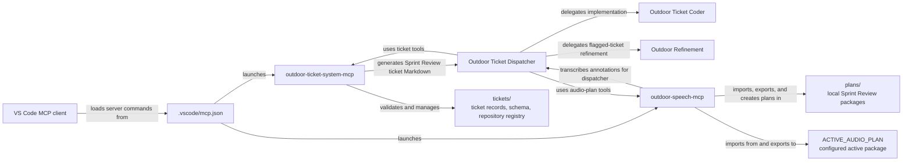
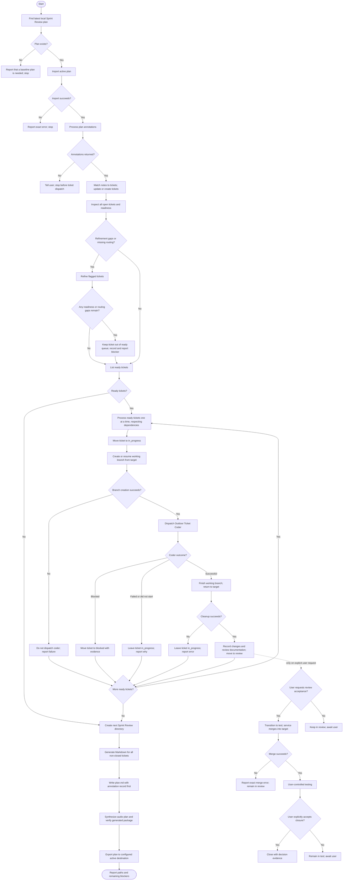

# Outdoor Speech MCP

`outdoor-speech-mcp` is a local MCP server for Azure Speech recognition and
synthesis. It uses MCP stdio transport, so an MCP client launches it as a
local process rather than connecting to an HTTP server.

## Requirements

- Python 3.10+
- Azure Cognitive Services Speech credentials
- An OpenAI API key to use `ask_llm` and synthesize audio plans
- `ffmpeg` on `PATH` for M4A transcription

## Azure Speech connection requirements

By default, the Speech SDK uses the configured Azure region. Speech recognition
connects to `wss://<region>.stt.speech.microsoft.com` and speech synthesis to
`wss://<region>.tts.speech.microsoft.com`. These are secure WebSocket
connections (TLS) over outbound TCP port 443. Allow DNS resolution and outbound
connections on port 443; no inbound ports are required. The endpoints' IP
addresses can change, so allow the service hostnames rather than fixed IPs.

To use a private endpoint, configure a custom domain and private endpoint for
the Azure Speech resource, and make sure the client network's private DNS
resolves the custom domain to the private endpoint IP. Set
`AZURE_SPEECH_ENDPOINT` to the custom endpoint URL shown for the Speech
resource, for example `https://<custom-name>.cognitiveservices.azure.com/`.
The SDK uses this endpoint instead of the region; keep `AZURE_SPEECH_KEY` set,
and `AZURE_SPEECH_REGION` is not needed when the endpoint is set. The client
still needs outbound TCP port 443 to the endpoint. Do not configure the private
IP directly as the endpoint; use the DNS name so TLS and private DNS work as
intended.

Creating a custom domain for a Speech resource is not reversible. See
[Microsoft's Speech private endpoint instructions](https://learn.microsoft.com/azure/ai-services/speech-service/speech-services-private-link)
for setup and DNS details.

## Install

```bash
cd outdoor-speech-mcp
python -m pip install -e .
```

Create a `.env` file in the repository root or export these variables. VS Code
loads this file for `outdoor-speech-mcp` through `.vscode/mcp.json`. The root
`.env` file is git-ignored; do not commit credentials.

```env
AZURE_SPEECH_KEY=your_speech_key_here
AZURE_SPEECH_REGION=your_region_here
# Optional: set this instead of AZURE_SPEECH_REGION when using a custom endpoint/private endpoint.
# AZURE_SPEECH_ENDPOINT=https://<custom-name>.cognitiveservices.azure.com/
OPENAI_API_KEY=your_openai_api_key_here
OPENAI_MODEL=gpt-4o-mini
LOG_FILE=/path/to/outdoor-speech-mcp.log
ACTIVE_AUDIO_PLAN=/path/to/audio-plan
AUDIO_PLAN_INTERVAL_SECONDS=10
```

Server logs are written to `~/.outdoor-speech-mcp.log` by default, with a
date/time stamp on each entry. The previous log is rotated at startup, keeping
the ten most recent backups. Set `LOG_FILE` to choose a different path and
`LOG_LEVEL` to adjust the verbosity.

## Configure an MCP client

Use the installed console script as the local MCP command:

```json
{
  "mcpServers": {
    "outdoor-speech": {
      "command": "/absolute/path/to/.venv/bin/outdoor-speech-mcp",
      "env": {
        "AZURE_SPEECH_KEY": "your_speech_key_here",
        "AZURE_SPEECH_REGION": "your_region_here",
        "OPENAI_API_KEY": "your_openai_api_key_here",
        "OPENAI_MODEL": "gpt-4o-mini"
      }
    }
  }
}
```

For a private endpoint, add `AZURE_SPEECH_ENDPOINT` with the custom endpoint
URL to the `env` object. When it is set, the service uses it instead of
`AZURE_SPEECH_REGION`.

The repository wrapper also starts the same server:

```bash
.venv/bin/python run.py
```

## MCP tools

- `run_speech_coordinator(message)` speaks a prompt, listens until the user
  says `submit`, and returns the collected transcript.
- `synthesize_audio_plan(filename, output_dir)` supports `.md` and `.py` files.
  Markdown uses the packaged markdown-to-TTS skill; Python source uses the
  python-to-TTS skill to explain code behavior in listenable prose. An OpenAI
  model transforms the source before the iOS-compatible plan is generated.
  Each timing sentence's `source_filename` is a Git file URL; explicit Markdown
  anchors are retained as URL fragments so annotations can be traced to a
  ticket.
- `latest_plan_name()` and `next_plan_name()` find existing and next local
  `Sprint Review N` names. `create_next_plan_dir()` creates the next local plan
  directory.
- `import_plan(plan_name)` copies `ACTIVE_AUDIO_PLAN` into `plans/`;
  `export_plan(plan_name)` deploys a local plan package to `ACTIVE_AUDIO_PLAN`.
  These tools replace the removed repository-root `plan_sync.py` script.
- `transcribe_annotation(audio_path)` creates the adjacent `.stt.txt` and
  `.stt.wav` files for an annotation recording.
- `process_plan_annotations(plan_path)` transcribes attached recordings when
  needed and returns each annotation's combined transcript with its sentence
  text, `source_file` Git URL, stable `<plan name>-<number>` anchor, and an
  `audioannotation://` URL that navigates to that annotation in the iOS app
  when its plan package is open.
- `ask_llm(prompt, model)` sends a text prompt to OpenAI and returns the model's
  text response. It uses `OPENAI_MODEL` when `model` is omitted (default
  `gpt-4o-mini`) and requires `OPENAI_API_KEY` in the MCP server environment.

The speech implementation and its local dependencies live in
`outdoor-speech-mcp/src/outdoor_speech_mcp`, including the local Sprint Review
plan synchronization helpers.

## Outdoor Ticket System MCP

`outdoor-ticket-system-mcp` manages repository-local tickets in `tickets/`.
Install it into the workspace virtual environment:

```bash
cd outdoor-ticket-system-mcp
../.venv/bin/python -m pip install -e .
```

VS Code discovers both MCP servers through `.vscode/mcp.json`. Ticket records
remain under `tickets/`; set `OUTDOOR_TICKET_ROOT` to override that location.
The speech server loads its credentials and optional settings from the
git-ignored repository-root `.env` file using VS Code's `envFile` setting.
Set `AZURE_SPEECH_KEY`, either `AZURE_SPEECH_REGION` or
`AZURE_SPEECH_ENDPOINT`, and `OPENAI_API_KEY` there; `OPENAI_MODEL` is
optional.
The service requires the schema in `tickets/README.md` and never creates a
parallel ticket store. Ticket mutations preserve append-only history and use
the documented state graph, including user-controlled `test` after `review`.
An explicit request to test a reviewed ticket merges its recorded working
branch into the target first; failures leave it in `review`. Registered
repositories may define `default_target_branch`, which is saved on a selected
ticket unless refinement supplies an override. Transitions to `refined`,
`ready`, or `closed` require `decision_evidence`; every transition requires
`evidence`. MCP records caller-supplied evidence but cannot authenticate who
supplied it.

The ticket tools are `list_tickets`, `get_ticket`, `validate_tickets`,
`create_ticket`, `update_ticket`, and `transition_ticket`. Use
`list_tickets(state="ready", output_mode="full")` to select implementation
work. Its `file-format="markdown"` mode returns the Sprint Review Plan from
all non-closed tickets by default. Save it as `plan.md` in a new local Sprint
Review directory, then use `synthesize_audio_plan` and `export_plan` from
`outdoor-speech-mcp` to generate and deploy the audio package.
Repository registration uses `list_repositories`, `get_repository`,
`create_repository`, `update_repository`, and `delete_repository`.
`select_ticket_repository` records a ticket's repository and resolved branches;
`create_working_branch` creates or resumes its implementation branch before
coder dispatch.

The speech MCP owns plan synchronization through `next_plan_name`,
`create_next_plan_dir`, `import_plan`, and `export_plan`. These tools replace
the former `plan_sync.py` command-line helpers. Import/export use
`ACTIVE_AUDIO_PLAN` and local `plans/` directories. The speech MCP requires
`AZURE_SPEECH_KEY`, either `AZURE_SPEECH_REGION` or `AZURE_SPEECH_ENDPOINT`,
and `OPENAI_API_KEY`.

## Project architecture

The repository's two local MCP servers are configured for the VS Code MCP
client. The dispatcher coordinates their tools and delegates ticket coding and
refinement; ticket records and local Sprint Review plans remain in this
workspace.



See the [dispatcher instructions](.github/agents/outdoor-ticket-dispatcher.agent.md),
[ticket schema](tickets/README.md), and [MCP configuration](.vscode/mcp.json).

## Outdoor Ticket Dispatcher workflow

The diagram follows the dispatcher instructions. Annotation and import failures
stop processing before ticket dispatch; an empty ready queue still proceeds to
the Sprint Review plan. The user-controlled review/testing path is separate
from the normal dispatch cycle.


